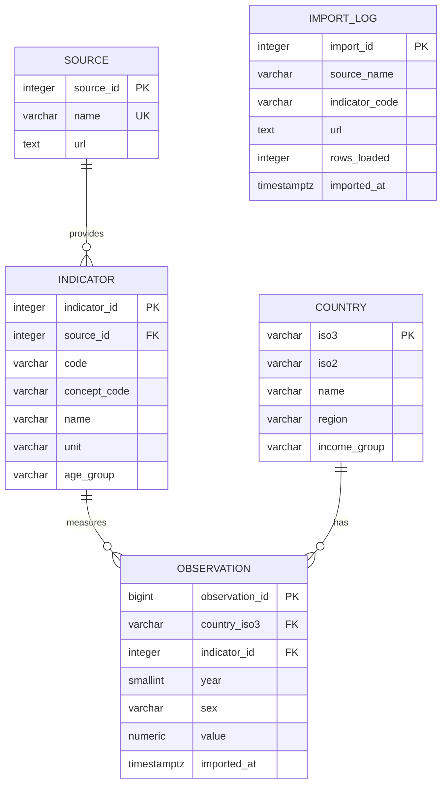

# Database design and schema

## Entity-relationship diagram

`import_log` is a separate audit table without foreign keys, following the lab design.

## Justified changes to the reference schema

- **Unique `(source_id, code)` for indicators**, instead of a globally unique code: two APIs may use the same code or publish the same concept. `indicator_id` identifies the series and source; observations do not need a redundant `source_id`.
- **`concept_code`** identifies a shared concept when source codes differ. It does not establish equivalence: units, definitions and populations must be checked.
- **Indicator-level `age_group`** records the distinction between vaccination at the recommended age, under-five mortality and all-age indicators. Each indicator has a fixed reference population in this version.
- **Longer code and unit fields** accommodate future API codes and explicit monetary units.
- **Additional constraints** enforce years 1900-2100, sex codes `BTSX/MLE/FMLE` and nonnegative values. Missing values remain `NULL`; indicator-specific limits, such as percentages from 0 to 100, are validated before loading.
- The observation key `(country_iso3, indicator_id, year, sex)` and index `(indicator_id, year)` are retained. Future loading will use this key for `ON CONFLICT DO UPDATE`, within the same transaction as import logging.

## Tools used for this design

SQLAlchemy implements the models and constraints; psycopg connects to PostgreSQL.
ReportLab generates the SVG ER diagram. The corresponding models, SQL design,
diagram generator and optional dependency are introduced in this schema commit.
