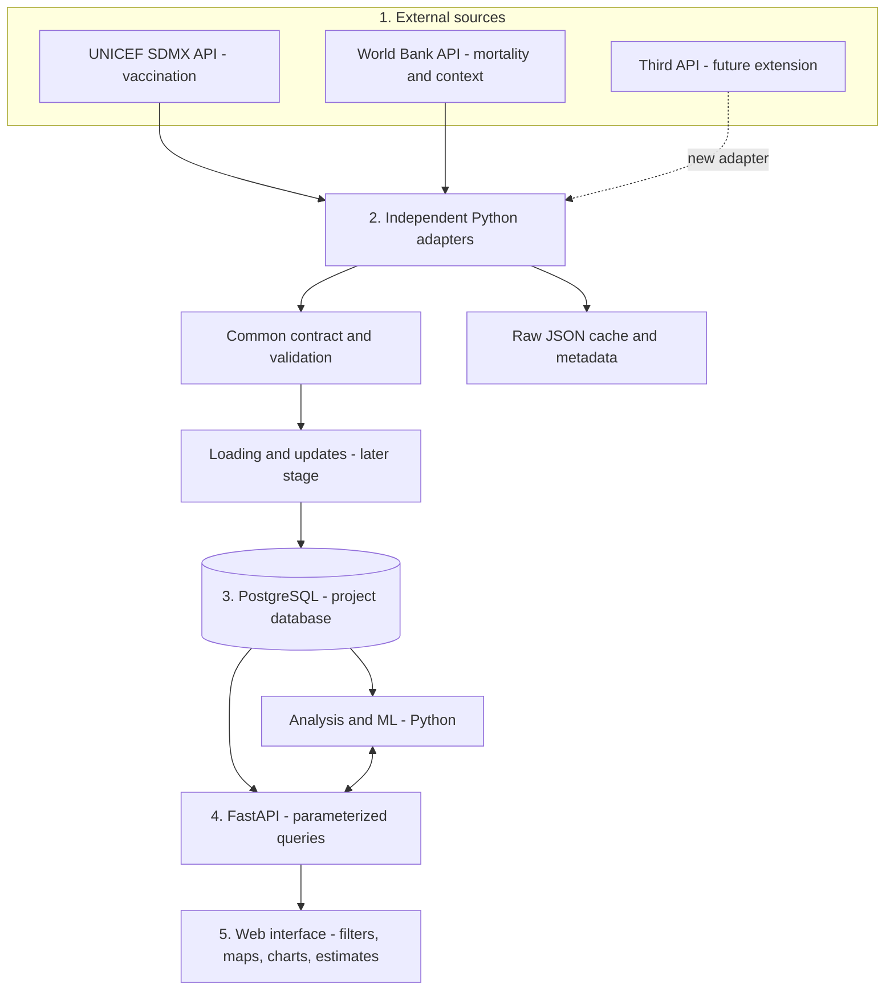
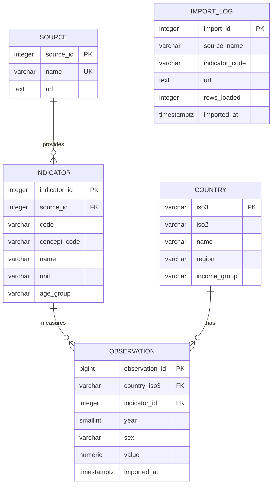

# Architecture and data model

## Five-layer architecture



Only the import pipeline will contact external sources and write observations to PostgreSQL. The application API and analysis modules will read the project database, and the interface will use the backend. Browsing will therefore be independent of UNICEF/World Bank response times, and the same data version can be reused to reproduce results. Table creation and migrations are administrative operations separate from data imports.

Source access, normalization, validation and the empty database work in Lab 1. Production loading, application endpoints, ML and the connected interface are planned for later stages.

Diagrams for the report and presentation:

- [Application architecture](diagrams/application-architecture.svg)
- [Database entity-relationship diagram](diagrams/database-erd.svg)

Dashed boxes and descriptions distinguish planned components from existing ones. The diagram is the Lab 1 design; UI implementation is reserved for Lab 3. The earlier prototype is preserved on the separate `codex/lab3-ui-prototype` branch.

## Component contracts

| Connection | Data and responsibilities |
|---|---|
| Sources -> adapters | HTTP GET, source-specific JSON, pagination and retries |
| Adapters -> validation | `source_name`, `indicator_code`, `country_iso3`, `year`, `sex`, `value` |
| Import -> PostgreSQL | Units and definitions stored separately; loading requires validation, transactions and upserts |
| FastAPI -> PostgreSQL | Parameterized SQLAlchemy queries; country, indicator and year filters |
| FastAPI <-> analysis/ML | Analysis reads the project data; the model will return an estimate, model version and evaluated performance |
| FastAPI -> interface | Jinja2 pages and API responses; Plotly charts in the final implementation |

Model training and saved model files are a separate future workflow. Models will not be retrained on every page view.

## Entity-relationship diagram



`import_log` is a separate audit table without foreign keys, following the lab design.

## Justified changes to the reference schema

- **Unique `(source_id, code)` for indicators**, instead of a globally unique code: two APIs may use the same code or publish the same concept. `indicator_id` identifies the series and source; observations do not need a redundant `source_id`.
- **`concept_code`** identifies a shared concept when source codes differ. It does not establish equivalence: units, definitions and populations must be checked.
- **Indicator-level `age_group`** records the distinction between vaccination at the recommended age, under-five mortality and all-age indicators. Each indicator has a fixed reference population in this version.
- **Longer code and unit fields** accommodate future API codes and explicit monetary units.
- **Additional constraints** enforce years 1900-2100, sex codes `BTSX/MLE/FMLE` and nonnegative values. Missing values remain `NULL`; indicator-specific limits, such as percentages from 0 to 100, are validated before loading.
- The observation key `(country_iso3, indicator_id, year, sex)` and index `(indicator_id, year)` are retained. Future loading will use this key for `ON CONFLICT DO UPDATE`, within the same transaction as import logging.

## Project structure

```text
app/                    connection, SQLAlchemy models, table creation
config/                 topic, pilot sample and indicator catalog
db/                     SQL design and PostgreSQL schema export
etl/                    contracts, API adapters, cache and validation
scripts/                local setup and schema verification
docs/                   explanations, diagrams and evidence
output/pdf/             submission report
notebooks/              reserved for exploration and ML
tests/                  JSON, pagination and extensibility checks
.local/                 PostgreSQL, pgAdmin and server data (ignored)
.venv/                  Python environment (ignored)
.env                    local connection and password (ignored)
```
