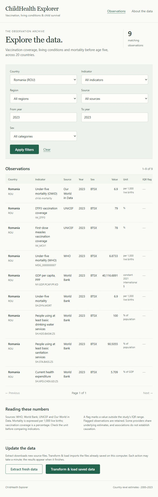
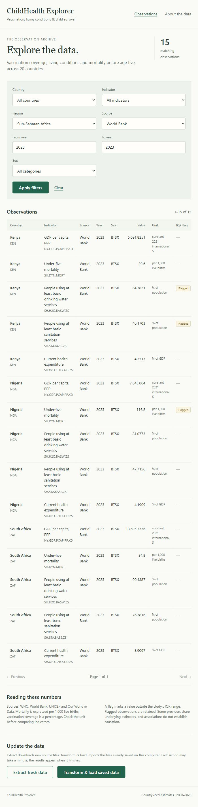
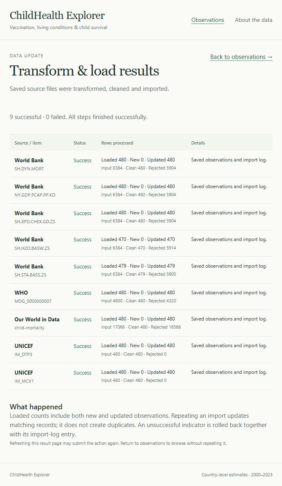

# Lab 3 - server-rendered application and layers

Verified on 13 November 2026 against the existing PostgreSQL database. The application is at **http://127.0.0.1:8000/**; start it with `scripts/start-web.ps1` after starting PostgreSQL. No JavaScript runs in the browser. The web interface uses the nine real source-specific series loaded in Lab 2.

## Layer boundaries

| Layer | Files | Owns | Does not contain |
|---|---|---|---|
| Presentation | `app/controllers/`, `app/templates/`, `app/views.py` | HTTP parsing, service calls, HTML/display formatting | SQL, ORM models, sessions, repository calls, extraction code |
| Service | `app/services/` | Pagination, year-range rules, filter options, pipeline orchestration | HTTP responses/requests, templates, queries or connections |
| DAL | `app/repositories/` | Parameterized SQL, joins, lookup queries and writes through injected sessions | HTTP, page rules or commit/rollback |
| Shared values | `app/domain.py`, `etl/step_result.py` | Immutable records, criteria and operation outcomes | HTTP objects or ORM result rows |

`app/dependencies.py` is the composition root. It creates repository/service combinations using the session dependency or pipeline session factory. `app/main.py` creates FastAPI, registers routers/static assets and translates a plain validation error into an HTTP response. `app/database.py` and the ORM models are shared infrastructure, not presentation code.

Only DAL code issues application database queries and writes. The pipeline runner owns transaction boundaries, as required by the lab; repositories never commit. The CLI and the browser use the same runner. Historic verification scripts query the database directly as checks, not as web application layers.

## Task 3.1 - two filtered pages and one action result

### A. Romania, 2023

Request:

```text
http://127.0.0.1:8000/?country=ROU&indicator=&region=&source=&year_from=2023&year_to=2023&sex=
```

Nine real observations are displayed, including vaccination, socioeconomic and source-specific mortality series. WHO mortality is 6.8733 per 1,000 births; World Bank and OWID mortality are 6.9. These are not artificially forced to the same precision.



Call chain for this request:

1. `GET /` routes to `show_observations()` in `app/controllers/observation_controller.py`.
2. The presentation dependency `observation_criteria()` parses strings into an immutable `ObservationCriteria`. Blank/invalid year fields become None.
3. Dependency injection supplies `ObservationService(ObservationRepository(session))`; the controller itself never sees the session or queries anything.
4. `ObservationService.get_page(criteria, 1)` validates page/year ordering, calls `ObservationRepository.count(criteria)`, computes limit/offset, then calls `ObservationRepository.find(criteria, limit=25, offset=0)`.
5. The repository's `_matching_observations()` and `_conditions()` build parameterized joins/filters. A total ordering ends in observation_id. It returns immutable ObservationListItem records, not ORM rows.
6. `get_filter_options()` obtains repository lookup values and enum choices. Jinja renders `observations.html`, extending `base.html`, with the page, criteria, options and pagination URLs. SQL and connection code never enter the template/controller.

### B. Sub-Saharan Africa, World Bank, 2023

Request:

```text
http://127.0.0.1:8000/?country=&indicator=&region=Sub-Saharan+Africa&source=worldbank&year_from=2023&year_to=2023&sex=
```

Fifteen observations cover Kenya, Nigeria and South Africa. The selected region, source and years remain visible in the form. Outlier flags are displayed without removing those observations.



### C. Transform & load from the browser

The form submits **POST /actions/load**. `etl_controller.transform_and_load()` calls one EtlService method; injected jobs invoke the shared import runner, which accesses data through ImportRepository. The result page reports each indicator's status and raw/clean/rejected/loaded/new/updated counts.



Two explicit browser imports completed, each with **9 successful indicators, 0 failures, 4,309 processed upserts, 0 new observations and 4,309 updates**. The observation count stayed 4,309, including 335 outliers. Import logs increased from the Lab 2 snapshot's 18 entries to 27, then 36. The final browser result is recorded in [browser load evidence](evidence/lab3-browser-load.txt); [database evidence](evidence/lab3-database-check.json) confirms zero duplicates.

`POST /actions/extract` is also wired to all source downloads plus country metadata, using the same catalog and refresh=True. Expected source failures render failed rows; programming exceptions are not swallowed. Its orchestration/presentation tests use stub jobs and cannot download files. A fresh network extraction was not required for these browser screenshots: the demonstrated action intentionally loaded the validated Lab 2 snapshots.

GET requests to both action paths return **405**, so following a link never starts the pipeline. Actions are synchronous and can take a minute. Refreshing a POST result can repeat the action; the result page states this. The app uses one shared process lock to reject overlapping pipeline operations in the local single-worker setup.

## Task 3.2 - trace the region through every layer

1. The `region` select in `app/templates/observations.html` submits a GET form. Its option values are populated from `options.regions`, and the matching option is selected again after rendering.
2. `observation_criteria(region=...)` strips blank input and places it into `ObservationCriteria.region`.
3. The controller sends that criteria object to `ObservationService.get_page`; the service forwards it to the repository while applying page rules.
4. `_conditions()` in the DAL adds `Country.region == criteria.region` as a bound SQLAlchemy predicate. `_matching_observations()` applies it to the country/observation join.
5. `ObservationRepository.list_regions()` reads distinct observed regions; the service puts these Option values in `FilterOptions.regions` and the template displays them.
6. Pagination links use `request.url.include_query_params(page=...)`, changing only page while keeping region and any other filters.

The exact demonstration was performed in the browser:

```text
http://127.0.0.1:8000/?region=Sub-Saharan+Africa
http://127.0.0.1:8000/?region=Sub-Saharan+Africa&page=2
```

There are **648 matching observations and 26 pages** with 25 rows per page. The UI moved from page 1 to page 2 and kept Sub-Saharan Africa selected. [Pagination evidence](evidence/lab3-region-pagination.json) records the two actual URLs.

### Region defect corrected during verification

World Bank returned `Sub-Saharan Africa ` and `Latin America & Caribbean ` with trailing spaces. Form parsing removed the spaces, so a bookmarked region did not equal the stored value. Country transformation now strips metadata labels before the normal DAL upsert; no normalization SQL was placed in presentation or services. A regression test reproduces the source payload. The database now contains zero region labels with surrounding spaces.

The dedicated commit is `Lab 3: trim region metadata so bookmarked region filters match`.

## Task 3.3 - sex filter

- `ObservationCriteria.sex` is typed as `Sex | None`.
- DAL `_conditions()` adds `Observation.sex == criteria.sex.value` only for a selected category.
- The presentation parser accepts BTSX, MLE and FMLE and ignores unknown codes.
- The service exposes all three enum options; the template keeps the selected value.
- Repository tests return only the selected sex. Service tests verify criteria forwarding and complete choices. The presentation request `/?sex=MLE&country=ROU` displays exactly one row in the synthetic fixture.

The approved live pilot contains BTSX totals only, so the same live URL correctly shows no observations. The synthetic male/female rows are isolated test data and were never inserted into the project database. This distinction prevents a test demonstration from misrepresenting the source data.

## Task 3.4 - automatic dependency rule

`tests/test_architecture.py` parses imports with ast, including relative imports and `from app import ...` forms. It rejects FastAPI, controllers and dependency wiring in the domain/repository/service layers. Additional checks reject database imports in presentation/services and commit/rollback calls in repositories.

The negative demonstration used the actual service file: temporarily add `import fastapi`, run the architecture tests, record the expected failure, then restore the original file byte-for-byte in a finally block. The captured output is in [the negative-test evidence](evidence/lab3-architecture-negative.txt). Its failure identified:

```text
app/services/observation_service.py imports fastapi
```

After restoration, all three architecture checks pass. The forbidden import is not present in the delivered code.

## Validation and delivery

- **39 tests pass**, including repository/loader/migration tests against real PostgreSQL in rolled-back synthetic schemas, service tests with fakes, controller tests with dependency overrides, the region regression and architecture checks.
- Presentation fixtures fail if a real database or ETL dependency is accidentally reached. Repository tests use TEST_DATABASE_URL or the configured project connection, with isolated schemas; they skip missing/unreachable databases.
- Ruff passes, Alembic reports no schema drift, and installed dependencies are consistent. Adding a Python Sex enum did not require changing the stored sex column.
- [Ten live HTTP checks](evidence/lab3-http-checks.json) verify filters, pagination, empty live male results, tolerated invalid year strings, rejected page 0, POST-only actions, CSS and disabled JSON API documentation.
- FastAPI, Uvicorn, Jinja2 and httpx2 are declared and locked with the component that uses them. CSS/assets are local; rendering does not require a JavaScript bundle.
- The original Lab 1/Lab 2 commits and evidence remain preserved. Lab 3 is delivered on main, with a commit for each layer/functionality and explicit messages for the two observed defects.
- [Prompt history](prompts/lab3.md) accompanies the code. [Checklist](lab3-checklist.md) maps all required tasks. No separate PDF report is required.
