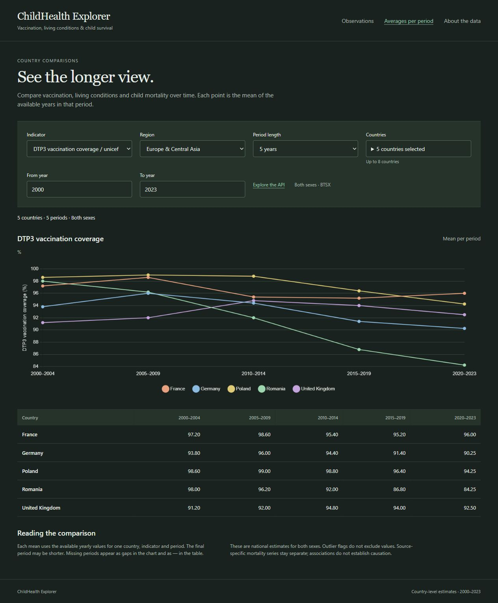
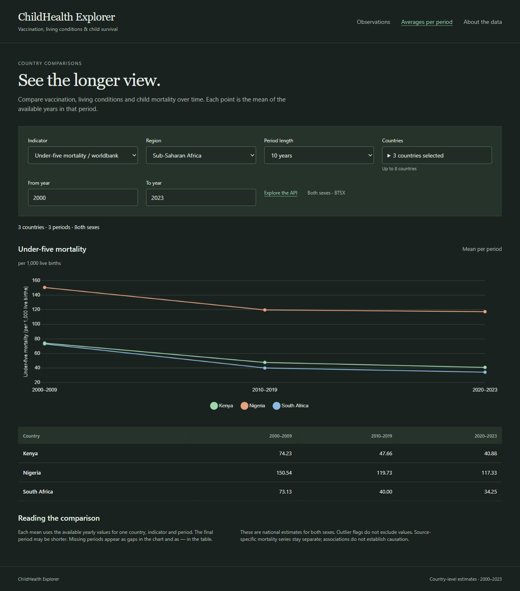
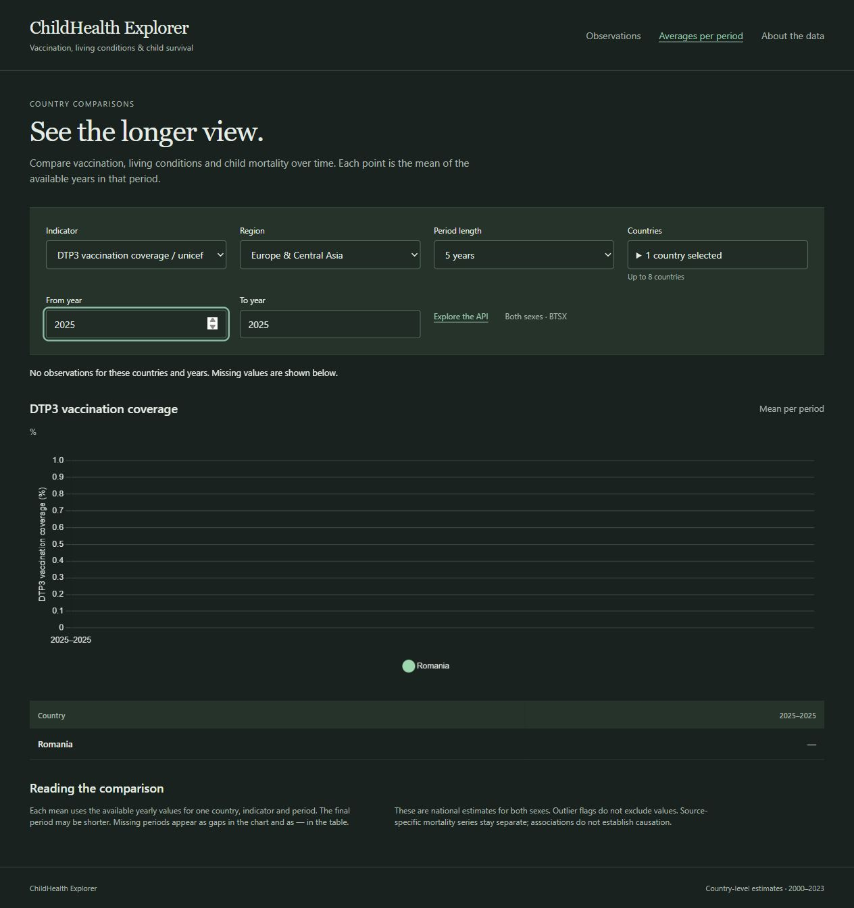
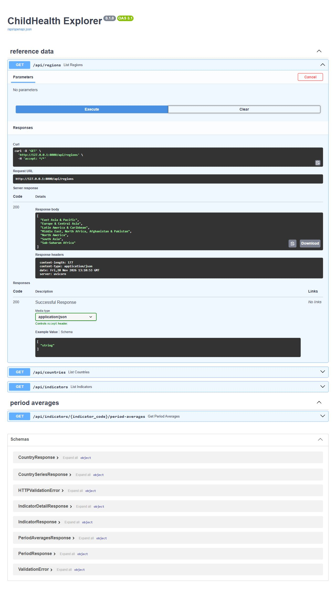

# Lab 4 - client-side comparisons and REST API

Verified on 20 November 2026. The application uses the existing 20-country,
2000-2023 study data. No new source downloads, production imports, indicators or
schema changes were required.

## Scope

The student approved using vaccination, socioeconomic conditions and under-five
mortality instead of the PDF's life-expectancy example. The PDF refers to Tasks
4.1, 4.2 and 4.4 without including their statements; the student explicitly asked
to ignore those references. This document records the implemented sections 4.1-4.10
and their verification, without claiming completion of missing task statements.
The sample commit messages do not define additional sex-choice or indicator-detail
features. The existing SSR sex filter is unchanged; averages use BTSX.

## Pages and API

Start PostgreSQL and the web server as described in the README.

- `/` remains the Lab 3 server-rendered observation browser, including GET filters,
  pagination and explicit POST extraction/import forms. It requires no JavaScript.
- `/period-averages` returns a database-independent HTML shell. JavaScript loads
  the lookups and report, then updates the chart/table when filters change.
- `/api/docs` provides interactive Swagger UI. `/api/openapi.json` contains only
  the four JSON endpoint paths; HTML and action routes are excluded.

| GET resource | Output |
|---|---|
| `/api/regions` | List of observed region names |
| `/api/countries?region=Europe+%26+Central+Asia` | ISO3 codes and plain country names in the region |
| `/api/indicators` | Indicator codes and source-labelled names |
| `/api/indicators/IM_DTP3/period-averages?country=ROU&country=FRA` | DTP3 means, by period and country |

Countries/regions/indicators come from the stored observation catalog. Omit region
for all observed countries; an unknown region returns an empty list. Repeating
country parameters selects multiple countries; duplicates are removed in their
request order. Report series are sorted by country name.

The report defaults to first_year=2000, last_year=2023 and period_years=5.
An empty country list is valid and returns periods with an empty series list.
The API accepts up to 20 unique countries and the chart UI up to 8. Years must be
ordered within the stored schema's 1900-2100 range. The last period can be shorter.

## Layered implementation

1. `reference_data_api.py` calls ObservationService for lookup lists. The new
   `period_average_api.py` parses the query and calls PeriodAverageService.
2. `schemas.py` maps domain values into Pydantic DTOs. Decimal averages become
   JSON numbers; missing values remain null. Internal IDs/counts are not exposed.
3. PeriodAverageService validates the query, finds the indicator, builds periods,
   rounds using Decimal/ROUND_HALF_UP and aligns each country's series.
4. PeriodAverageRepository computes bucketed AVG/count in PostgreSQL using bound
   parameters, excluding null observations and filtering to Sex.BOTH. It never
   commits. The bucket subquery avoids repeated bound GROUP BY expressions.
5. `dependencies.py` supplies the injected repository/session. Controllers and
   templates contain no SQL, sessions or direct repository calls.

Known countries remain in the report even if every period lacks observations.
No missing value is replaced by zero. Outlier flags do not remove measurements.
Means are arithmetic averages of available annual estimates; missing years do
not count in the denominator. Source-specific mortality indicators are kept
separate, including estimates that share an underlying UN IGME source.

| Browser module | Responsibility |
|---|---|
| `api-client.js` | Only fetch calls; URL encoding, repeated parameters, response.ok and ApiError |
| `period-averages-model.js` | Defaults, selections, stable colors and table/chart transformations; no DOM/network |
| `period-averages-view.js` | DOM and Chart.js rendering; API text uses textContent |
| `period-averages-page.js` | Events, requests and coordination; aborts old requests and guards response identity |

Both report and country-lookup requests are protected against late responses.
Keeping a country selected preserves its color. Selecting with the keyboard
preserves the checkbox focus after redraw. The chart uses straight lines,
spanGaps=false and no animation; the accessible table gives exact two-decimal
values. If the Chart.js CDN is unavailable, the view is designed to leave the
table usable and show a notice. A blocked-CDN browser scenario was not simulated.

## Verified real comparisons

### DTP3 vaccination, Europe, five-year periods

The page defaults to IM_DTP3, Europe & Central Asia and Romania, France, Germany,
United Kingdom and Poland. The report has five periods from 2000-2004 through
2020-2023. For Romania, the displayed means are 98.00, 96.20, 92.00, 86.80 and
84.25 percent. France has 97.20, 98.60, 95.40, 95.20 and 96.00 percent.

The independent read-only SQL check for Romania, 2020-2023 returns
round(avg(value),2)=84.25, equal to the API's numeric 84.25. See
[database evidence](evidence/lab4-database-check.json).

### Under-five mortality, Sub-Saharan Africa, ten-year periods

Changing indicator to SH.DYN.MORT, region to Sub-Saharan Africa and period length
to ten updates the same page to Kenya, Nigeria and South Africa. The periods are
2000-2009, 2010-2019 and 2020-2023. Kenya's means are 74.23, 47.66 and 40.88 per
1,000 live births. The table and chart update through API calls.

### Empty data and invalid selections

- At eight selected countries, attempting a ninth leaves eight selected and shows
  `Choose at most 8 countries.`
- Removing every selected country clears the old chart/table and asks for a country.
- Romania in 2025-2025 returns a null average because the approved data ends in
  2023; the table shows a dash and no invented chart point.
- Setting the start year after the end clears old results and shows a year-range error.
- Space toggles the focused Romania checkbox without losing focus.
- The browser console had no JavaScript warnings/errors during the verified flows.

### Interactive API documentation

Opened `/api/docs`, expanded GET /api/regions, selected Try it out and Execute.
Swagger displayed the actual request URL, HTTP 200, JSON region list and response
headers. The HTTP evidence also records a valid averages response, JSON 404 for
an unknown indicator, and JSON 422 for malformed/reversed years, zero period
length, unknown countries and more than 20 countries.

## SSR and CSR comparison

| Behavior | Existing observations page | New period-averages page |
|---|---|---|
| Initial response | Complete Jinja HTML with data | Empty controls/results plus JavaScript modules |
| Filter update | GET navigation returns new HTML | fetch returns JSON; JavaScript updates table/chart |
| Without JavaScript | Works | Shell and a link to Observations |
| Data access | Service -> repository -> PostgreSQL | REST controller -> service -> repository -> PostgreSQL |
| External chart library | None | Chart.js 4.4.1 from the lab's jsDelivr URL |

## Verification and reproduction

- 59 Python tests pass, including old labs and isolated real-PostgreSQL repository
  tests. Synthetic data is rolled back; it never becomes project observations.
- 10 Node tests pass: encoded URLs, HTTP errors, selection limit, stable colors,
  aligned null/zero values, validation and out-of-order report/region responses.
- 19 live HTTP checks pass; reproduce with `python -m scripts.check_lab4` from
  the project environment while the app runs. This only reads the API and refreshes
  [HTTP evidence](evidence/lab4-http-checks.json).
- Ruff passes; Alembic reports no new upgrade operations; pip check reports no
  broken requirements. Pydantic was already installed through FastAPI and is now
  declared directly because this project imports it. No dependency installation
  or schema migration was needed for Lab 4.
- The database retains 4,309 observations, 335 outlier flags, 36 import logs and
  zero duplicate natural keys, at Alembic revision 0002. No extraction/import
  action was run for this lab's checks.
- The existing browser dark preference was used for screenshots. No browser
  responsive viewport override or light-mode simulation was applied.
- [Prompt history](prompts/lab4.md) accompanies each implementation commit.
  [Checklist](lab4-checklist.md) maps the agreed scope. Delivery is on main;
  master remains the submitted Lab 2 snapshot. No separate report PDF is required.

Technical references used alongside the lab: [FastAPI response models](https://fastapi.tiangolo.com/tutorial/response-model/),
[Chart.js lines and gaps](https://www.chartjs.org/docs/latest/charts/line.html),
and [Chart.js instance cleanup](https://www.chartjs.org/docs/latest/developers/api.html).
